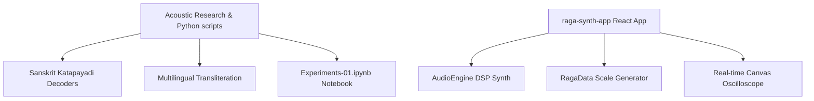

# 🎼 Musical Acoustics Playground

A repository dedicated to the exploration of musical acoustics, digital signal processing (DSP), and Indian Classical musicology (Carnatic Melakarta Raga scale systems).

This workspace houses research scripts, Jupyter notebooks for physical audio modeling, and an interactive React-based synthesizer web application.

---

## 🗺️ Project Ecosystem



### 1. The Interactive React App (`raga-synth-app`)
A fully-featured client-side browser synthesizer.
*   **Location:** [raga-synth-app/]
*   **Features:** Physical synthesis of 6 instruments (Piano, Violin, Human Male & Female Formant Voices, Sitar, Veena), a 3-octave Swara keyboard, dynamic practice sequencers, a real-time oscilloscope visualizer, and dual visual themes (Cyber vs Classical Parchment).
*   For detailed documentation on the synthesis math and app layout, see the [raga-synth-app README](file:///Users/narasimhanm.g./Desktop/Playground/MusicalAcoustics/raga-synth-app/README.md).

### 2. Physical Acoustics Notebooks
*   **[Experiments-01.ipynb]:** Includes scripts to generate and play any or all of the 12 standard Western music notes in an octave across 3 octaves, utilizing different synthesized instrument/voice profiles.

### 3. Sanskrit Script & Decoding Utilities
*   **[katapayadi.py]:** Decodes Sanskrit/Kannada raga names into Melakarta index numbers (1-72) based on the ancient *Katapayadi* Sanskrit alphanumeric rule (*"Ankanam Vamato Gathi"* - numbers are read right-to-left).
*   **[transliterate.py]** Handles text transliteration across Indian scripts (Kannada, Devanagari, IAST, ITRANS) for raga names.

---

## 🚀 Installation & Running

### 1. Running the Interactive Synthesizer Web App
To compile and launch the React client:
```bash
# Navigate to the app directory
cd raga-synth-app

# Install dependencies
npm install

# Run the dev server
npm run dev
```
Open `http://localhost:5173` in your browser.

### 2. Running Python Scripts and Notebooks
To run the physical synthesis notebooks:
```bash
# Create/activate virtual environment
source .venv/bin/activate

# Install requirements
pip install numpy scipy pandas jupyter indic-transliteration

# Launch notebook workspace
jupyter notebook
```
Open [Experiments-01.ipynb] inside Jupyter.
